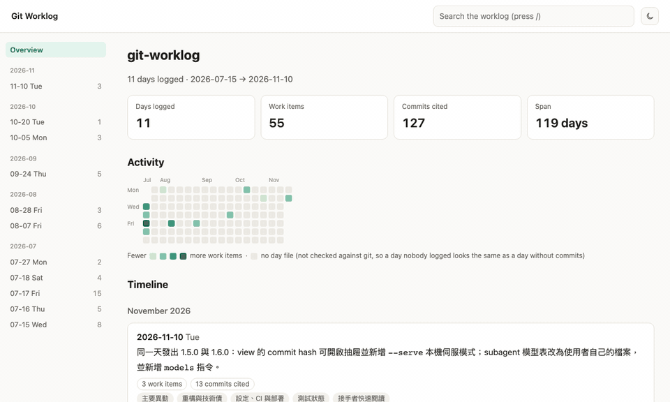
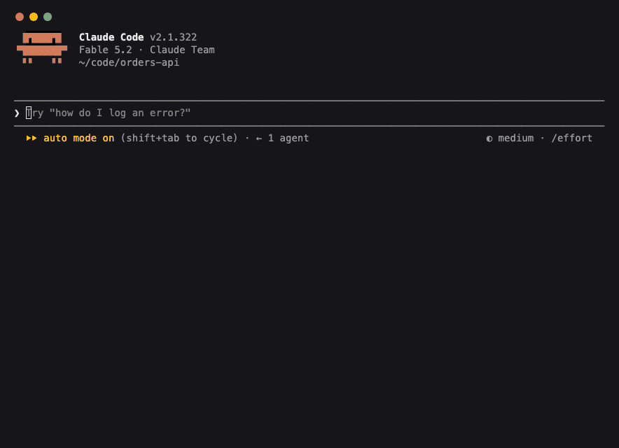
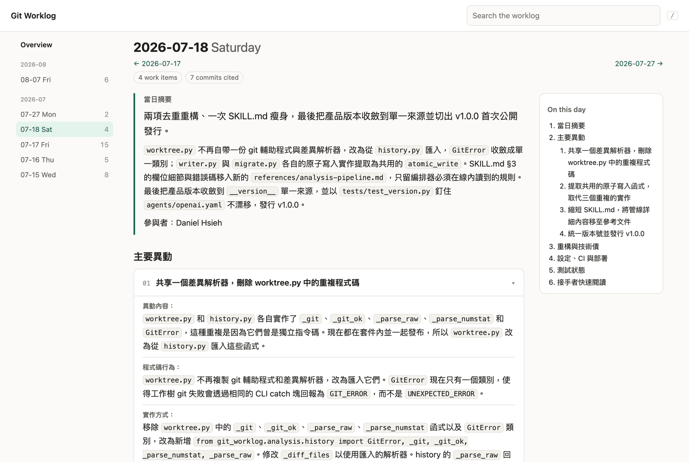
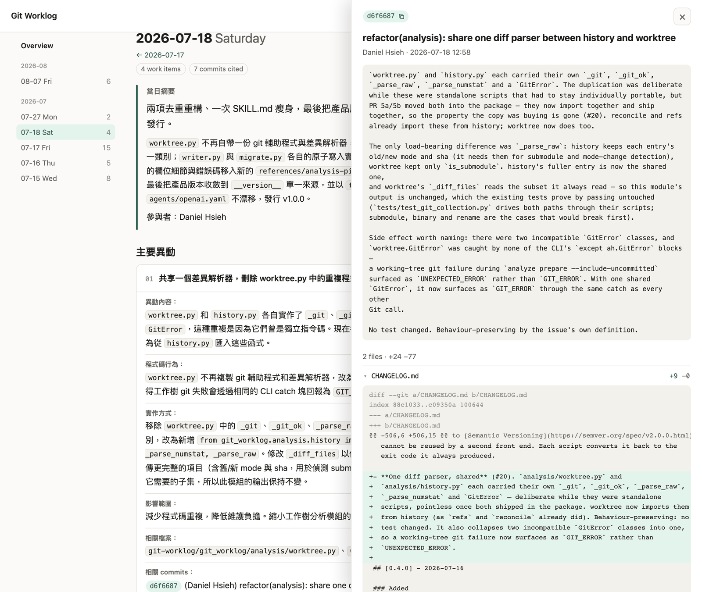

<div align="center">

# Git Worklog

**Your Git history already knows what the team did. Git Worklog writes it down.**

An agent skill that reads the real diffs — not the commit messages — and keeps a
per-day project worklog inside your repository. Then it answers questions from
it: weekly summaries, release changelogs, handoffs, outstanding tech debt.

[](https://github.com/g761007/git-worklog/actions/workflows/ci.yml)
[](https://github.com/g761007/git-worklog/releases/latest)
[](LICENSE)


**English** · [繁體中文](README.zh-TW.md)

**[Live demo](https://g761007.github.io/git-worklog/)** — this repository's own worklog, rendered by `git-worklog view`



</div>

## Why

- **Commit messages are a poor record.** `fix`, `wip` and `address review` say
  nothing about what the code does now. The diff does.
- **Summarising `git log` only rephrases it.** Hand an LLM a list of commit
  messages and it returns the same messages in nicer prose — and fills the gaps
  with guesses.
- **Reports get written from memory.** The weekly update, the release notes and
  the handoff document are all reconstructed by hand, usually late, usually
  from whatever someone remembers.

Git Worklog reads each day's patches and the code around them, writes down what
actually changed and why it matters, and checks its own work before showing it
to you. Nothing reaches your repository until you have read the preview and said
yes.

## Quick start

**1. Install.** Paste this line into Claude Code, Codex, Gemini or any agent that
can run shell commands:

```text
Install the git-worklog agent skill for me: download https://github.com/g761007/git-worklog/releases/latest/download/skill.zip, unzip it, and move the git-worklog/ folder inside into your user-level skills directory (for Claude Code, ~/.claude/skills/); if a git-worklog skill is already there, ask me before replacing it.
```

The link always resolves to the newest release, so the same line upgrades an
existing install. Prefer to do it by hand? Unzip
[`skill.zip`](https://github.com/g761007/git-worklog/releases/latest/download/skill.zip)
and copy the `git-worklog/` folder into `~/.claude/skills/`. Nothing is installed
and nothing is compiled — the engine sits in that folder and runs on the Python
standard library alone.

On Claude Code you can install it as a plugin instead:

```text
/plugin marketplace add g761007/git-worklog
/plugin install git-worklog@git-worklog
```

A plugin's skills are namespaced, so the command is then
`/git-worklog:git-worklog` rather than `/git-worklog`.

**2. Run it** inside any Git repository:

```text
/git-worklog
```

**3. Pick from the menu**, or just say what you want:

```text
/git-worklog days=7
/git-worklog from=2026-07-01 to=2026-07-10
/git-worklog last week, including what I have not committed yet
```

**4. Read the preview and confirm.** Every request ends in a dry-run showing
exactly what would be written. Only after you confirm do the files land:

```
.git-worklog/
├── index.md          # every day, newest first, one-line summary each
└── days/
    ├── 2026-07-15.md # exactly one day per file
    └── ...
```



*A real Claude Code session on a three-commit sample repository whose commit
messages are `fix`, `wip` and `address review`. Waiting time is shortened.*

You type `/git-worklog` yourself — the skill never starts on its own because of
something you said in passing.

## What a day looks like

One work item from this repository's
[own worklog](.git-worklog/days/2026-08-07.md) (translated from zh-TW and
trimmed; the [index](.git-worklog/index.md) lists every day):

> ### Git golden rule clarified: what is forbidden is acting on its own initiative
>
> - **What changed:** `SKILL.md` §0 used to say "never run git
>   add/commit/push/…", which read literally blocked even a user asking, in
>   their own words, to commit the result — but that is the user's decision
>   about their own repo, not something this skill is entitled to veto.
> - **Code behaviour:** The wording becomes "never … on your own initiative".
>   What it really has to stop is the "the worklog is written, so I should
>   commit it while I am here" kind of self-directed reasoning.
> - **Impact:** An agent no longer has to choose between doing what the user
>   asked and obeying the skill. A clarification, not a relaxation: the skill
>   itself still never touches git state unprompted.
> - **Files:** `git-worklog/SKILL.md`, `README.md`, `CHANGELOG.md`
> - **Commits:** 4265dde (Daniel Hsieh) docs(skill): the git rule is "never on
>   your own initiative", not "never"

The commit message was one line. The entry says what the rule used to block,
what it blocks now, and why — because it was written from the diff.

## What it does

### Generate — a worklog built from diffs

- **One file per day**, covering the whole project and every author, with a
  summary, the work items, the files and commits behind each, and the risks and
  follow-ups worth remembering.
- **Today, a date, the last 7 or 30 days, or a custom range** — up to 30 days
  per run, optionally including uncommitted changes.
- **Written in your language.** The worklog follows the language you ask in, not
  the language of the repository: English commits and an English codebase still
  produce a zh-TW or ja worklog if that is how you asked.
- **Your notes survive.** Each day file and the index have a `MANUAL` region
  that is preserved verbatim on every re-run.

### Report — ask instead of digging

Once days are logged, ask questions. Reports are read-only — the answer comes
back in the conversation and nothing is written.

```text
/git-worklog summarise last week's work
/git-worklog changelog for v1.0.1
/git-worklog I am handing this project over — key points and open items from the last month
/git-worklog what did Daniel work on last month
/git-worklog how did member search evolve
/git-worklog what tech debt and follow-ups are outstanding
```

- **Release scopes are resolved by commit set, not by date** — `v1.0.1` means
  `git log v1.0.0..v1.0.1`, so cherry-picks and commits that straddle a release
  land in the right changelog.
- **Gaps are reported, not papered over.** If a date in the range has commits
  but no worklog, the skill says so and offers to fill it in first. It never
  quietly falls back to summarising commit messages.
- **Report language is independent of the worklog's** — zh-TW day files can
  produce an English release note. Reports cover up to 90 days.

### View — the worklog as one page

`git-worklog view` renders the worklog into a single self-contained HTML page:
an overview with an activity calendar, every day with a table of contents and
collapsible work-item cards, search across all of it, and light and dark themes.
Click a commit hash and a drawer opens with its message, files and — under
`--serve` — each file's diff.





The viewer is part of the optional CLI — see [CLI reference](docs/cli.md).

## How it works

```
 1. prepare    CLI     decides what each day is answerable for
 2. analyse    agent   one subagent per day reads the patches and the code
 3. collect    CLI     checks every answer before believing it
 4. preview    CLI     freezes the exact final text of every file
 5. confirm    you     read it, then say yes
 6. apply      CLI     writes those bytes — or refuses
```

The deterministic work — date math, Git collection, Markdown surgery, preview
integrity — is plain Python. The judgement work — reading code and deciding what
changed — is done by the agent you are already running, which is why **no model
API key is needed**.

The split is what makes the result checkable. `collect` verifies that every
prepared day came back, that every evidence citation resolves against the tree
of the commit it names, and that no source file the day changed went
undescribed. A day whose analysis never arrived is reported as `missing`, never
as a day where nothing happened.

## Why you can trust it

- **Dry-run first, always.** Nothing is written without explicit confirmation.
- **What you approved is what gets written.** `apply` accepts a preview id and
  nothing else, so no re-render can reach the disk.
- **It refuses rather than guesses.** If HEAD, a day file, the index or the
  analysis moved after the preview, the apply is rejected and tells you which.
- **Writes are transactional.** A failed run never leaves some days updated and
  others not.
- **It never touches Git on its own.** No `git add`, `commit` or `push` unless
  you separately ask your agent for it.

The full list is in the [safety model](docs/safety-model.md).

## Requirements

- **Python 3.9+** — standard library only, no third-party packages.
- **Git 2.37+**.
- An agent host that loads skills — see below.

### Agent hosts

| Host | Skills folder | How you start it | Status |
|---|---|---|---|
| Claude Code | `~/.claude/skills/` | `/git-worklog` | Developed and tested here |
| Codex | `~/.agents/skills/` | `$git-worklog`, or pick it from `/skills` | Experimental |
| Gemini CLI | `~/.gemini/skills/` | Ask for a worklog; the model activates the skill | Experimental |

The skill is plain `SKILL.md` plus Python, so it loads anywhere the Agent Skills
format does. Only Claude Code is exercised end to end on every release; on the
other hosts the folder and the invocation above come from each host's
documentation, and a full run has not been verified. Reports of what works and
what does not are welcome in
[Discussions](https://github.com/g761007/git-worklog/discussions).

## The CLI (optional)

The same engine ships a `git-worklog` command for terminals and CI. The skill
does not need it; install it when you want the viewer, validation or the
pipeline on its own:

```bash
uv tool install "git+https://github.com/g761007/git-worklog@v1.6.0"

git-worklog view       # read the worklog as one web page
git-worklog doctor     # is this environment able to run the tool?
git-worklog validate   # is the worklog on disk well-formed?
```

Every command, the install options and the `analyze` → `preview` → `apply`
pipeline are in the [CLI reference](docs/cli.md).

## FAQ

**Do I need an API key?**
No. The analysis runs on the agent host you invoke the skill from.

**Does my code go anywhere new?**
The engine makes no network calls. The only thing that reads your code is the
agent you are already using, under whatever terms you already use it.

**What does it cost?**
Each day is analysed by a subagent on a cost-first model by default (Claude
Haiku 4.5 / GPT-6 Luna / Gemini 3.8 Flash). The table is a file of your own and
you can change it — see [Configuration](docs/configuration.md).

**Will it commit or push for me?**
No. It writes the day files and stops.

**Should `.git-worklog/` be committed?**
That is up to you. It is plain Markdown designed to live in the repository, so
the team shares one worklog and reports work for everyone who clones it.

**Can I edit a day file by hand?**
Write inside its `MANUAL` region and it is kept on every re-run. The generated
region is overwritten when that day is re-analysed.

**I already keep a single `docs/PROJECT_WORKLOG.md`.**
`/git-worklog migrate` splits it into day files once, previews first and never
deletes the original.

## Documentation

| | |
|---|---|
| [Usage](docs/usage.md) | The menu, invocation arguments, reporting, legacy migration |
| [CLI reference](docs/cli.md) | Installing the CLI, every command, the viewer |
| [Configuration](docs/configuration.md) | Language, timezone, subagent models, the state directory |
| [Safety model](docs/safety-model.md) | Every guarantee about what is written, and when it is refused |
| [Development](docs/development.md) | Repository layout, tests, building the release archive |
| [Changelog](CHANGELOG.md) | What changed in each release |

## Contributing

Issues and pull requests are welcome — [CONTRIBUTING.md](CONTRIBUTING.md) has
the ground rules. Questions and ideas go to
[Discussions](https://github.com/g761007/git-worklog/discussions); security
reports go through [SECURITY.md](SECURITY.md).

The test suite is standard-library `unittest` and needs nothing installed:

```bash
python3 -m unittest discover -s tests -v
```

See [Development](docs/development.md) for the layout and the release build.

## License

Released under the [MIT License](LICENSE).
