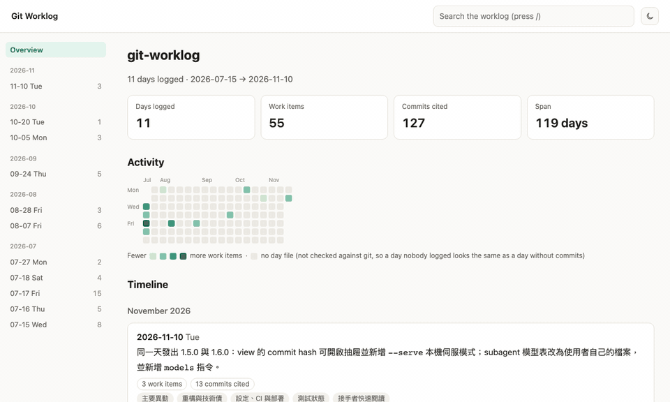
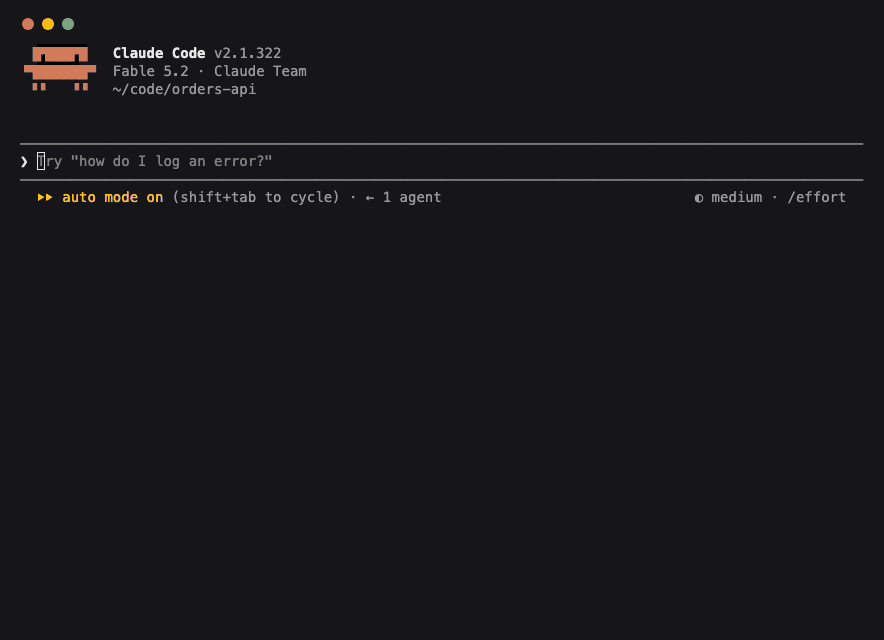
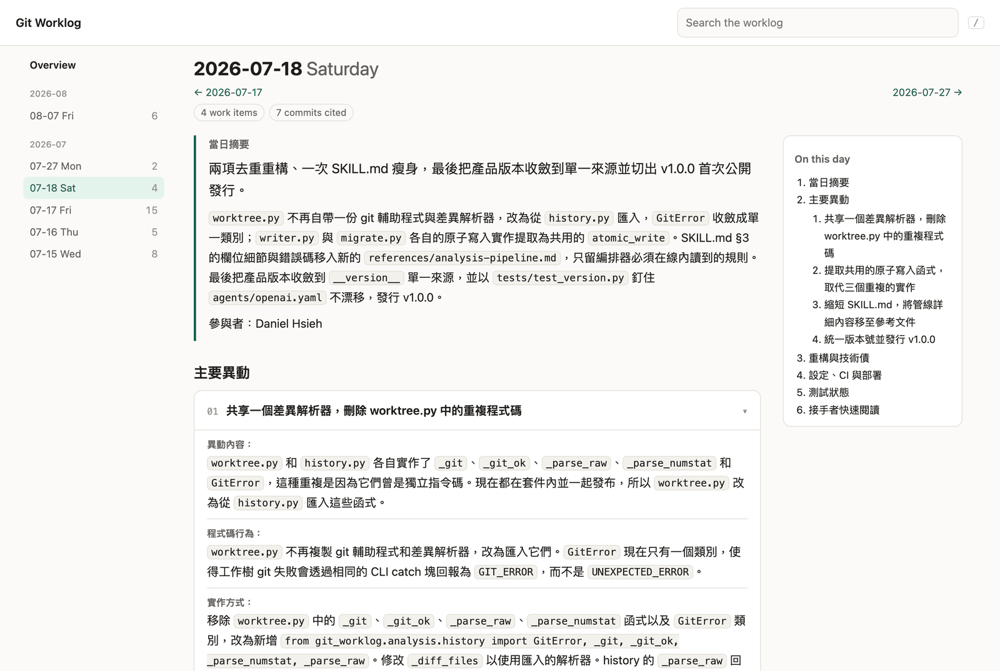
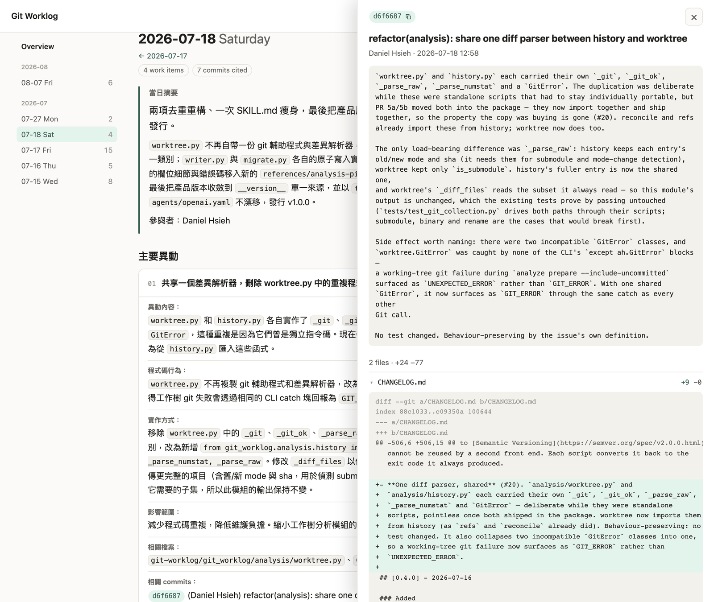

<div align="center">

# Git Worklog

**團隊做了什麼，Git 歷史早就知道。Git Worklog 把它寫下來。**

一個 agent skill：讀的是真正的 diff，不是 commit message，在你的 repository 裡維護一份
逐日的專案工作日誌。接著直接從日誌回答問題——週報、版本 changelog、交接摘要、
累積的技術債。

[](https://github.com/g761007/git-worklog/actions/workflows/ci.yml)
[](https://github.com/g761007/git-worklog/releases/latest)
[](LICENSE)


[English](README.md) · **繁體中文**

**[線上 demo](https://g761007.github.io/git-worklog/)**——這個 repository 自己的工作日誌，由 `git-worklog view` 渲染



</div>

## 為什麼需要它

- **Commit message 不是好的紀錄。** `fix`、`wip`、`address review` 完全沒說程式現在
  做了什麼；diff 才有。
- **摘要 `git log` 只是換句話說。** 把一串 commit message 丟給 LLM，拿回來的是同一串
  訊息的漂亮版本——空白的地方則用猜的補上。
- **報告都是憑記憶寫的。** 週報、release note、交接文件，全靠人工重建，通常很晚才寫，
  通常只寫得出還記得的部分。

Git Worklog 會讀每一天的 patch 與周邊程式碼，寫下實際改了什麼、為什麼重要，並在給你看
之前先檢查自己的產出。在你讀過預覽並明確同意之前，不會有任何東西寫進你的 repository。

## 快速開始

**1. 安裝。** 把下面這一行貼給 Claude Code、Codex、Gemini 或任何能執行 shell 指令的
agent：

```text
幫我安裝 git-worklog 這個 agent skill：下載 https://github.com/g761007/git-worklog/releases/latest/download/skill.zip，解壓縮後把裡面的 git-worklog/ 資料夾放進你的使用者層級 skills 目錄（Claude Code 是 ~/.claude/skills/）；如果那裡已經有 git-worklog，先問我再取代。
```

這個連結永遠指向最新的 release，所以同一行也能用來升級。想自己動手的話：解壓縮
[`skill.zip`](https://github.com/g761007/git-worklog/releases/latest/download/skill.zip)，
把 `git-worklog/` 資料夾複製到 `~/.claude/skills/` 即可。不需要安裝任何東西，也不需要
編譯——引擎就在那個資料夾裡，只用 Python 標準庫執行。

在 Claude Code 上也可以改用 plugin 的方式安裝：

```text
/plugin marketplace add g761007/git-worklog
/plugin install git-worklog@git-worklog
```

plugin 提供的 skill 會帶命名空間，所以指令會變成 `/git-worklog:git-worklog`，而不是
`/git-worklog`。

**2. 在任何 Git repository 裡執行：**

```text
/git-worklog
```

**3. 從選單挑一項**，或直接說你要什麼：

```text
/git-worklog days=7
/git-worklog from=2026-07-01 to=2026-07-10
/git-worklog 整理最近 7 天，包含目前還沒有 commit 的修改
```

**4. 看過預覽再確認。** 每個請求都會先產生 dry-run，完整顯示將寫入的內容；確認之後
檔案才會落地：

```
.git-worklog/
├── index.md          # 所有日期，由新到舊，各附一行摘要
└── days/
    ├── 2026-07-15.md # 一天一個檔
    └── ...
```



*在一個只有三個 commit 的範例 repository 上實際執行的 Claude Code 工作階段，commit
message 分別是 `fix`、`wip`、`address review`。等待時間經過縮短。*

`/git-worklog` 要你自己打——skill 不會因為你隨口提了一句就自行啟動。

## 一天的日誌長什麼樣子

以下是這個 repository [自己的工作日誌](.git-worklog/days/2026-08-07.md)裡的一個工作
項目（略有刪節；[索引](.git-worklog/index.md)列出所有日期）：

> ### git 黃金法則語意澄清：禁止的是主動執行，不是使用者要求也不行
>
> - **異動內容：** `SKILL.md` §0 原本寫「絕不執行 git add/commit/push/…」，字面上連
>   使用者自己用自己的話要求把結果 commit 掉都被擋下——但那是使用者對自己 repo 的
>   決定，不是這個 skill 有資格否決的事。
> - **程式碼行為：** 措辭改為「絕不主動執行／never … on your own initiative」。真正
>   要擋的是「日誌寫完了，所以我應該順手 commit」這種自作主張的推理。
> - **影響範圍：** 讓 agent 在使用者明確要求時不必在「照做」與「遵守 skill 規則」
>   之間二選一。這是澄清而非放寬：skill 自己仍然絕不主動碰 git 狀態。
> - **相關檔案：** `git-worklog/SKILL.md`、`README.md`、`CHANGELOG.md`
> - **相關 commits：** 4265dde (Daniel Hsieh) docs(skill): the git rule is "never on
>   your own initiative", not "never"

那個 commit message 只有一行。日誌卻交代了規則原本擋住什麼、現在擋什麼、以及為什麼——
因為它是從 diff 寫出來的。

## 它能做什麼

### 產生——從 diff 寫出來的工作日誌

- **一天一個檔**，涵蓋整個專案與所有作者：當日摘要、各工作項目、背後的檔案與
  commit，以及值得記住的風險與待追蹤事項。
- **今天、指定日期、最近 7 天或 30 天、自訂區間**——每次最多 30 天，可選擇納入尚未
  commit 的修改。
- **用你的語言寫。** 日誌跟著你提問的語言走，不是跟著 repo 的語言：commit 與程式碼全是
  英文，用中文提問得到的仍是 zh-TW 日誌。
- **你的筆記不會被蓋掉。** 每個日期檔與索引都有 `MANUAL` 區段，每次重跑都逐字保留。

### 報告——用問的，不用翻

日誌累積之後，直接提問即可。報告是唯讀的——答案回在對話裡，不寫任何檔案。

```text
/git-worklog 整理上一週工作摘要
/git-worklog 整理 v1.0.1 CHANGELOG
/git-worklog 我要交接，整理最近一個月的重點與待辦
/git-worklog Daniel 上個月做了什麼
/git-worklog 會員搜尋這功能是怎麼演進的
/git-worklog 目前累積哪些技術債與待追蹤事項
```

- **版本範圍以 commit 集合界定，不是日期**——`v1.0.1` 指的是
  `git log v1.0.0..v1.0.1`，所以 cherry-pick 與跨版本的 commit 都會落在正確的
  changelog 裡。
- **有缺漏會明講，不會矇混過去。** 範圍內某天有 commit 卻沒有日誌時，skill 會告訴你並
  詢問是否先補齊，絕不默默降級成摘要 commit message。
- **報告語言與日誌語言互相獨立**——zh-TW 的日誌可以產出英文的 release note。報告範圍
  最多 90 天。

### 檢視——把日誌變成一頁網頁

`git-worklog view` 把工作日誌渲染成單一、自含的 HTML 頁面：含活動日曆的總覽、每一天的
目錄與可收合的工作項目卡片、跨全部日誌的搜尋，以及淺色／深色主題。點一下 commit hash，
旁邊會滑出抽屜顯示它的訊息與變更檔案——以 `--serve` 執行時還能展開每個檔案的 diff。





檢視頁屬於選用的 CLI——見 [CLI 參考](docs/zh-TW/cli.md)。

## 運作方式

```
 1. prepare    CLI     決定每一天必須交代哪些東西
 2. analyse    agent   每天一個 subagent，讀 patch 與周邊程式碼
 3. collect    CLI     先檢查每份答案，再決定要不要相信
 4. preview    CLI     凍結每個檔案的最終內容
 5. confirm    你      讀過之後說「好」
 6. apply      CLI     寫入那份位元組——或者拒絕
```

確定性的工作——日期運算、Git 收集、Markdown 改寫、preview 完整性——是單純的 Python。
需要判斷的工作——讀程式碼、判定到底改了什麼——交給你正在用的那個 agent，這正是
**不需要模型 API key** 的原因。

這樣的分工讓結果可以被檢查。`collect` 會確認每個準備過的日期都有交回來、每條 evidence
引文都能在它所引用的 commit 的 tree 上對得上、當天改到的原始碼沒有任何一個檔案沒被
描述到。分析沒交回來的日子會被報成 `missing`，絕不會被當成「這天沒事發生」。

## 為什麼可以放心用

- **一律先 dry-run。** 未經明確確認絕不寫入。
- **你同意的那份，就是寫進去的那份。** `apply` 只收 preview id，任何重新產生的內容都
  沒有路徑可以抵達磁碟。
- **寧可拒絕，也不猜。** 預覽之後只要 HEAD、某個日期檔、索引或分析結果動過，apply 就
  拒絕並指出是哪一項。
- **寫入是交易式的。** 失敗不會留下「部分日期已更新」的狀態。
- **絕不主動碰 Git。** 不會 `git add`、`commit` 或 `push`，除非你另外要求你的 agent。

完整清單見[安全模型](docs/zh-TW/safety-model.md)。

## 需求環境

- **Python 3.9+**——僅標準庫，無第三方套件。
- **Git 2.37+**。
- 能載入 skill 的 agent 宿主——見下表。

### Agent 宿主

| 宿主 | Skills 目錄 | 啟動方式 | 狀態 |
|---|---|---|---|
| Claude Code | `~/.claude/skills/` | `/git-worklog` | 在此開發與測試 |
| Codex | `~/.agents/skills/` | `$git-worklog`，或從 `/skills` 選取 | 實驗性 |
| Gemini CLI | `~/.gemini/skills/` | 直接要求整理工作日誌，由模型啟用 skill | 實驗性 |

這個 skill 就是單純的 `SKILL.md` 加上 Python，所以任何支援 Agent Skills 格式的宿主都能
載入。每次發版只有 Claude Code 會完整跑過一遍；其他宿主的目錄與啟動方式取自各自的官方
文件，完整流程尚未驗證。歡迎到
[Discussions](https://github.com/g761007/git-worklog/discussions) 回報實際可用與不可用的
情況。

## CLI（選用）

同一套引擎另外提供 `git-worklog` 指令，給終端機與 CI 使用。skill 不需要它；想用檢視頁、
驗證，或單獨驅動流程時再安裝：

```bash
uv tool install "git+https://github.com/g761007/git-worklog@v1.6.0"

git-worklog view       # 以單一網頁閱讀工作日誌
git-worklog doctor     # 這個環境跑得動嗎？
git-worklog validate   # 磁碟上的工作日誌格式正確嗎？
```

所有指令、安裝方式，以及 `analyze` → `preview` → `apply` 流程，都在
[CLI 參考](docs/zh-TW/cli.md)。

## 常見問題

**需要 API key 嗎？**
不需要。分析跑在你呼叫 skill 的那個 agent 宿主上。

**我的程式碼會被送到新的地方嗎？**
引擎本身不發出任何網路請求。會讀你程式碼的，只有你本來就在用的 agent，條款也是你
本來就在用的那一份。

**要花多少錢？**
每一天由一個 subagent 分析，預設使用成本優先的模型（Claude Haiku 4.5／GPT-6 Luna／
Gemini 3.8 Flash）。這份模型表是你自己的檔案，可以修改——見
[設定](docs/zh-TW/configuration.md)。

**它會幫我 commit 或 push 嗎？**
不會。它寫完日期檔就停下。

**`.git-worklog/` 該不該 commit？**
由你決定。它是設計來放在 repository 裡的純 Markdown：commit 之後，團隊共用同一份日誌，
每個 clone 的人都能直接產生報告。

**可以手動修改日期檔嗎？**
寫在它的 `MANUAL` 區段裡，每次重跑都會保留。自動產生的區段在該日重新分析時會被覆寫。

**我已經有一份單檔的 `docs/PROJECT_WORKLOG.md`。**
`/git-worklog migrate` 會一次性把它拆成日期檔：先預覽，而且絕不刪除原檔。

## 文件

| | |
|---|---|
| [使用方式](docs/zh-TW/usage.md) | 選單、呼叫參數、報告、舊檔遷移 |
| [CLI 參考](docs/zh-TW/cli.md) | 安裝 CLI、所有指令、檢視頁 |
| [設定](docs/zh-TW/configuration.md) | 語言、時區、subagent 模型、狀態目錄 |
| [安全模型](docs/zh-TW/safety-model.md) | 關於「寫入什麼、何時拒絕」的每一項保證 |
| [開發](docs/zh-TW/development.md) | 目錄結構、測試、打包發布用的封存檔 |
| [Changelog](CHANGELOG.md) | 每個版本的變更 |

## 參與貢獻

歡迎提 issue 與 pull request——基本規則見 [CONTRIBUTING.md](CONTRIBUTING.md)。提問與
想法請到 [Discussions](https://github.com/g761007/git-worklog/discussions)；安全性問題請依
[SECURITY.md](SECURITY.md) 回報。

測試只用標準庫的 `unittest`，不需安裝任何東西：

```bash
python3 -m unittest discover -s tests -v
```

目錄結構與發布打包見[開發](docs/zh-TW/development.md)。

## 授權

以 [MIT License](LICENSE) 釋出。
