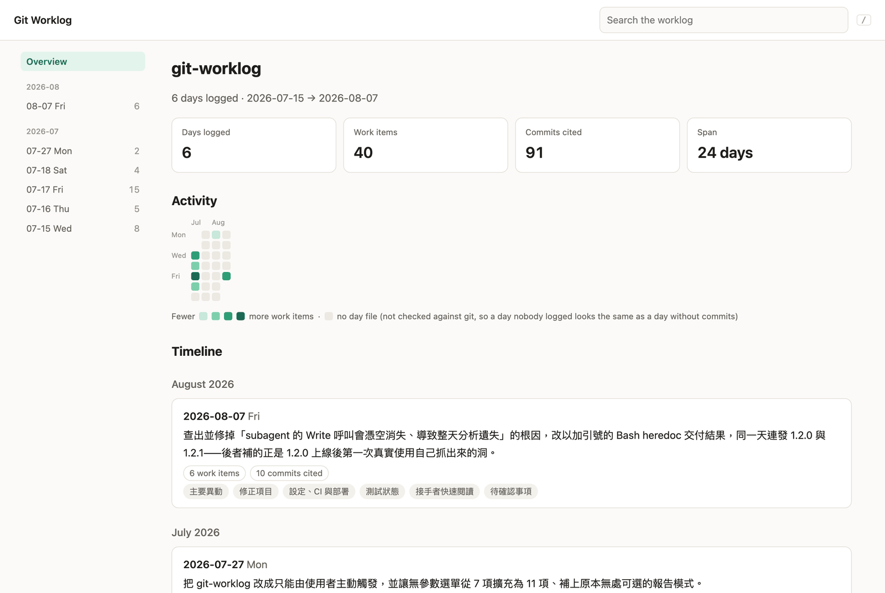
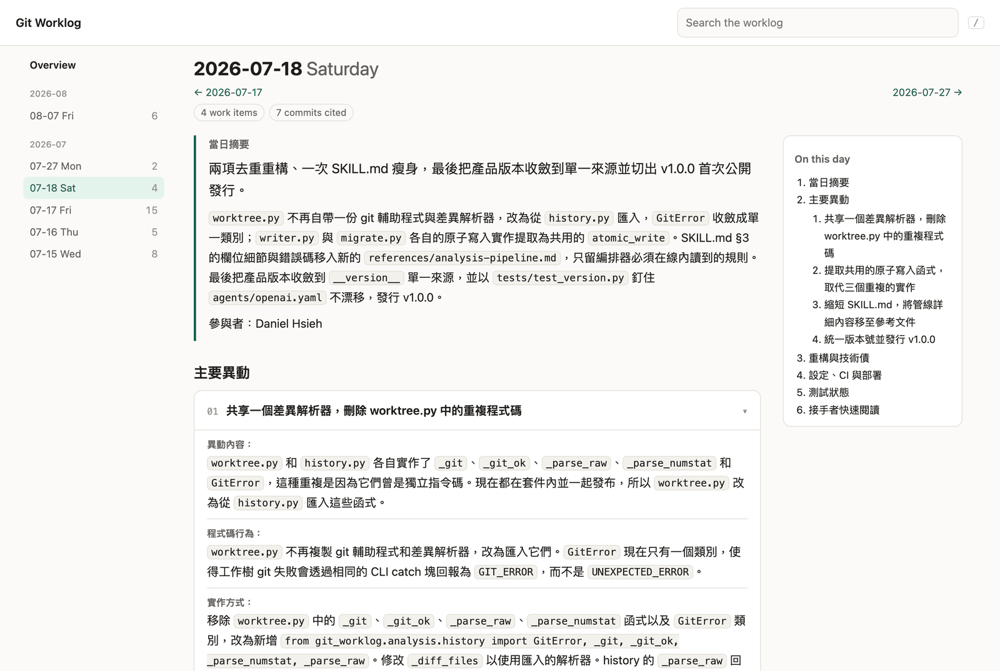
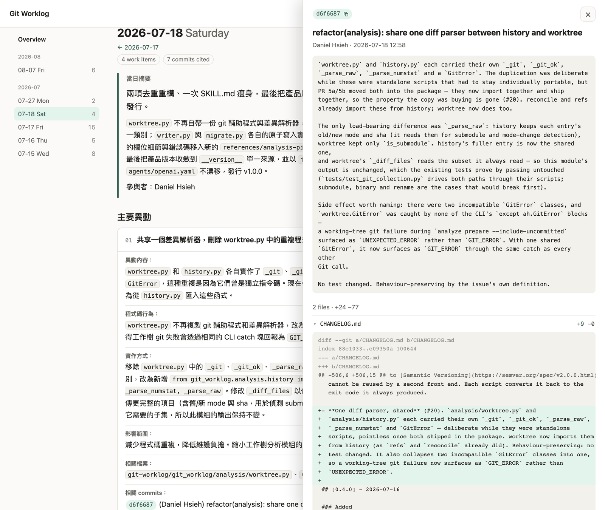

# CLI reference

**Languages:** English · [繁體中文](zh-TW/cli.md) — [← back to the README](../README.md)

The same engine also ships a `git-worklog` command. **The skill does not need
it** — it is for driving the deterministic parts yourself, from a terminal or
from CI.

The quickest way is to let your coding agent install it. Paste this one line:

```text
Install the git-worklog CLI for me: find the latest release tag at https://github.com/g761007/git-worklog/releases and run uv tool install "git+https://github.com/g761007/git-worklog@<that tag>" (add --force if git-worklog is already installed; if uv is missing, ask me before installing it), then run git-worklog version to confirm it is on my PATH.
```

It always picks the newest release, so the same line also upgrades an existing
install.

To do it by hand: the package is defined by the repository's root
`pyproject.toml`, not by anything inside the skill folder, so install it from
the repository: a copy of the skill, or `skill.zip`, has nothing to install. With
[uv](https://docs.astral.sh/uv/), which gives the command an environment of its
own and puts it on your PATH:

```bash
uv tool install "git+https://github.com/g761007/git-worklog@v1.6.0"
```

Put the release you want in the tag (see
[Releases](https://github.com/g761007/git-worklog/releases)); leave it off to
track `main`. To upgrade, run the same command with the new tag and `--force`.
From a clone, `uv tool install .` installs the working tree, uncommitted edits
included. With pip, use a virtual environment — uv's `pip`, and the
externally managed Pythons of Homebrew and Debian, refuse `pip install .`
outside one:

```bash
python3 -m venv .venv && .venv/bin/pip install .
```

Once `git-worklog` is on your PATH, Git runs it as `git worklog` as well. The
commands:

```bash
git-worklog version    # CLI / layout / config-schema versions
git-worklog doctor     # is this environment able to run the tool?
git-worklog validate   # is the worklog on disk well-formed?
git-worklog analyze    # prepare per-day analysis tasks, and collect them back
git-worklog preview    # freeze what an apply would write
git-worklog apply      # write a frozen preview
git-worklog view       # read the worklog as one web page (read-only)
git-worklog models     # show or change the subagent model each host uses
```

Without installing, the same commands run straight from the skill folder —
`git-worklog` here, or wherever you copied the skill:

```bash
PYTHONPATH=git-worklog python3 -m git_worklog --text doctor
```

Each prints one JSON object (`--text` for a human-readable rendering). Exit `0`
means ok, `1` means it ran and found a problem, `2` means it could not run.

`analyze` is the pair of commands that bracket an analysis without performing
it:

```bash
git-worklog analyze prepare --from 2026-07-01 --to 2026-07-07 \
    --timezone Asia/Taipei --language zh-TW --language-source user-request
# → one manifest per day under ~/.git-worklog/analysis/<run_id>/tasks/,
#   each naming the result_path its analysis must be written to.

git-worklog analyze collect --run-id <run_id>
# → reads the results back and checks them: every prepared day arrived, none
#   drifted language, every evidence citation resolves against the tree of the
#   commit it names, and no source file the day changed went undescribed.
```

Between the two, something has to actually read the patches and write the
prose — and that something is your agent's model, not the CLI. This is why no
model API key is needed: `prepare` only decides *what* must be analysed, and
`collect` only decides whether to believe the answer. A day whose analysis never
arrived is reported as `missing`, never as a day where nothing happened.

That last check is the one that catches quiet failures. An analysis can cite
three real files perfectly, never mention the other twenty the day changed, and
still call itself complete and verified — so `prepare` marks which files the day
is answerable for (source only; docs, config, tests, binaries and deletions are
excused) and `collect` fails any day that leaves one undescribed.

`preview` and `apply` then close the loop:

```bash
git-worklog preview --run-id <run_id> <<'JSON'
{"entries": {"2026-07-15": {"generated_markdown": "## 當日摘要\n..."}}}
JSON
# → a preview_id. Every target file's *final text* is stored under
#   ~/.git-worklog/previews/, along with the repository, worklog, run and
#   language fingerprints it depends on. Nothing is written.

git-worklog apply --preview-id <preview_id>
# → re-checks all of those, then writes exactly the stored bytes.
```

A preview id is the only thing `apply` accepts. That is deliberate: the day's
prose enters once, before the user reads it, and there is no argument through
which a re-render could reach the disk. If anything moved in between — HEAD, a
day file, `index.md`, the analysis results, the project's language — apply
refuses and says which, rather than writing something close enough. Previews
expire after 24 hours, apply exactly once, and take a per-worklog lock so two of
them cannot interleave.

`view` is the one command for reading rather than for the pipeline. It renders
`.git-worklog/` into one self-contained HTML page and opens it in your browser:
an overview with counts, an activity calendar and a timeline; every day with its
summary, a table of contents and collapsible work-item cards; and search across
all of it. It follows your system's light or dark setting until you pick one
with the switch in the top right, which the browser then remembers. Commit
hashes show as badges: click one and a drawer opens beside the text with that
commit's message, author, date and the files it changed — and, when the page is
served with `--serve`, each file's diff. A hash Git does not know (rebased away,
or missing from a shallow clone) copies itself instead.







```bash
git-worklog view                          # from the repository root
git-worklog view --no-open                # write the page, start no browser
git-worklog view --output handoff.html    # a copy to hand over
git-worklog view --serve                  # serve it locally, with diffs; Ctrl+C stops
```

It is read-only — nothing in the repository or the worklog is written. Git is
asked only about the commits the worklog cites, so the page is not a history
browser, and its numbers still describe the worklog, not the repository:
*commits cited* is what the prose mentions, and an empty calendar cell means "no
day file", which is what a day nobody logged and a day without commits both look
like (`coverage` is the command that tells them apart). The page goes to
`~/.git-worklog/view/` under a name fixed per worklog, so re-running the command
and reloading the tab refreshes it. It embeds the whole worklog, so it is
written owner-only; share an `--output` copy only where the source may be read.
Everything a day file says is escaped before it is shown, and the page's
Content-Security-Policy lets its one script run and nothing load, so a worklog
that quotes `<script>` shows the text.

Diffs are source code by the megabyte, so the page file never carries them.
`--serve` writes no file: it serves the page on `127.0.0.1`, on a port the
system picks, and reads a commit's diff from Git when you open it. It prints its
JSON first — `url` is where the page is — and then runs until you interrupt it;
reloading the tab rebuilds the page. The URL contains a token made for that run,
because a local port is reachable by every user of the machine and the page file
is owner-only: a request without the token, or one that names the server by any
host other than `127.0.0.1`, is refused, and only commits the worklog cites can
be asked for. `--serve` and `--output` do not combine.

Two environments need `--output`. The Snap builds of Firefox and Chromium (the
Ubuntu defaults) cannot read hidden directories in your home, so a page under
`~/.git-worklog/` opens as "access denied": write it somewhere visible. And on a
machine with no display, `view` writes the page and reports `opened: false`
rather than starting a terminal browser.

More commands — cleanup, init — arrive as the CLI grows; today those live in the
skill.
