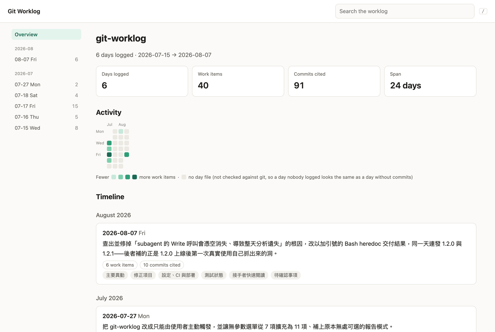
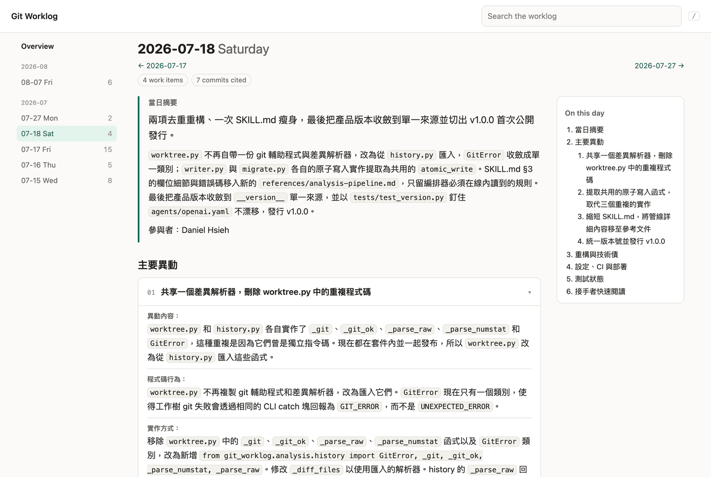
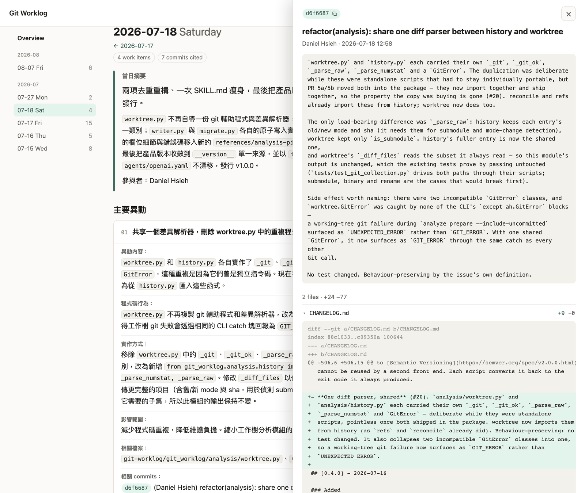

# CLI 參考

**語言：** [English](../cli.md) · 繁體中文 — [← 回到 README](../../README.zh-TW.md)

同一套引擎另外提供 `git-worklog` 指令。**skill 不需要它**——它是給你在終端機或 CI
裡自行驅動確定性部分用的。

最快的方式是交給你的 coding agent 安裝。把下面這一行貼給它：

```text
幫我安裝 git-worklog CLI：到 https://github.com/g761007/git-worklog/releases 找最新的 release tag，執行 uv tool install "git+https://github.com/g761007/git-worklog@<那個 tag>"（如果已經裝過就加上 --force；如果沒有 uv，先問我再安裝），最後執行 git-worklog version 確認它已在 PATH 上。
```

它一律安裝最新的 release，所以同一行也能用來升級既有的安裝。

要自己動手的話：這個套件已上架
[PyPI](https://pypi.org/project/git-worklog/)。建議用
[uv](https://docs.astral.sh/uv/)，它會替這個指令建立獨立的環境，並放進你的 PATH：

```bash
uv tool install git-worklog      # 也可以用 pipx install git-worklog
uv tool upgrade git-worklog      # 之後要升級到最新的 release 時
uvx git-worklog view             # 或完全不安裝、直接執行一次
```

若要改從 repo 安裝——PyPI 上沒有的 tag，或 `main`——請注意這個套件是由 repo 根目錄的
`pyproject.toml` 定義的，不在 skill 資料夾裡：skill 的複本或 `skill.zip` 裡沒有可以
安裝的東西。同樣用
[uv](https://docs.astral.sh/uv/)，它會替這個指令建立獨立的環境，並放進你的 PATH：

```bash
uv tool install "git+https://github.com/g761007/git-worklog@v1.6.1"
```

tag 填你要的版本（見 [Releases](https://github.com/g761007/git-worklog/releases)）；
不加 tag 則會安裝 `main`。要升級時，換成新的 tag 並加上 `--force` 重跑即可。在 clone
裡執行 `uv tool install .` 會安裝工作目錄的內容，包含尚未 commit 的修改。若用 pip，
請先建立虛擬環境——uv 的 `pip`，以及 Homebrew、Debian 這類 externally managed 的
Python，都會拒絕在虛擬環境以外執行 `pip install .`：

```bash
python3 -m venv .venv && .venv/bin/pip install .
```

`git-worklog` 進入 PATH 之後，Git 也能以 `git worklog` 執行它。可用的指令：

```bash
git-worklog version    # CLI／佈局／設定 schema 版本
git-worklog doctor     # 這個環境跑得動嗎？
git-worklog validate   # 磁碟上的工作日誌格式正確嗎？
git-worklog analyze    # 建立每日分析任務，再把結果收回來驗證
git-worklog preview    # 凍結這次 apply 會寫入的全部內容
git-worklog apply      # 寫入某份已凍結的 preview
git-worklog view       # 以單一網頁閱讀工作日誌（唯讀）
git-worklog models     # 查看或修改各宿主使用的 subagent 模型
```

不安裝的話，同樣的指令可直接從 skill 資料夾執行——這裡是 `git-worklog`，或你複製
skill 過去的位置：

```bash
PYTHONPATH=git-worklog python3 -m git_worklog --text doctor
```

每個指令輸出單一 JSON 物件（`--text` 可切成人類可讀格式）。離開碼 `0` 表示正常、
`1` 表示執行成功但發現問題、`2` 表示指令本身無法執行。

`analyze` 是一對指令，它們框住分析、但不執行分析：

```bash
git-worklog analyze prepare --from 2026-07-01 --to 2026-07-07 \
    --timezone Asia/Taipei --language zh-TW --language-source user-request
# → 在 ~/.git-worklog/analysis/<run_id>/tasks/ 下每天產生一份 manifest，
#   每份都指定該日分析結果必須寫入的 result_path。

git-worklog analyze collect --run-id <run_id>
# → 把結果讀回來檢查：每個準備過的日期都有交、沒有任何一天語言跑掉、
#   每條 evidence 引文都能在它所引用的那個 commit 的 tree 上對得上，
#   而且當天改到的原始碼沒有任何一個檔案沒被描述到。
```

在這兩步之間，總得有人真的去讀 patch、寫出敘述——那是你的 agent 的模型，不是 CLI。
這正是不需要模型 API key 的原因：`prepare` 只決定**該分析什麼**，`collect` 只決定
要不要相信答案。分析沒交回來的日子會被報成 `missing`，絕不會被當成「這天沒事發生」。

最後那項檢查抓的是最安靜的失敗：一份分析可以把三個檔案引用得完美無缺、卻對當天改動的
另外二十個檔案隻字未提，而它看起來依然「完整、已驗證」。所以 `prepare` 會標出當天該負責
的檔案（只限原始碼；文件、設定、測試、二進位檔與刪除的檔案都豁免），`collect` 則會讓
任何漏掉的日子失敗。

`preview` 與 `apply` 收尾：

```bash
git-worklog preview --run-id <run_id> <<'JSON'
{"entries": {"2026-07-15": {"generated_markdown": "## 當日摘要\n..."}}}
JSON
# → 回傳 preview_id。每個目標檔案的**最終內容**都存進 ~/.git-worklog/previews/，
#   連同它所依賴的 repository、worklog、run 與語言指紋。此時不寫入任何檔案。

git-worklog apply --preview-id <preview_id>
# → 重新驗證上述全部項目，然後寫入「存起來的那份位元組」。
```

`apply` 只收 preview id，這是刻意的：當天的敘述只在使用者過目之前進入工具一次，之後
沒有任何參數能讓重新產生的內容抵達磁碟。中間只要有東西動過——HEAD、某個日期檔、
`index.md`、分析結果、專案語言設定——apply 就會拒絕並指出是哪一項，而不是寫入一份
「差不多」的內容。Preview 24 小時後過期、只能套用一次，並且會取得 per-worklog 鎖，
避免兩次 apply 交錯。

`view` 是唯一一個「給人讀」而不是給流程用的指令。它把 `.git-worklog/` 渲染成一個自含
的 HTML 頁面並用瀏覽器開啟：總覽（統計、活動日曆、時間軸）、每一天的摘要、目錄與可收合
的工作項目卡片，以及跨所有日誌的搜尋。頁面預設跟隨系統的淺色／深色設定；用右上角的按鈕
切換之後，瀏覽器會記住你的選擇。commit hash 會顯示成 badge：點一下，內文旁會滑出抽屜，
顯示該 commit 的訊息、作者、日期與變更的檔案——以 `--serve` 提供頁面時，還能展開每個檔案
的 diff。Git 不認得的 hash（已被 rebase 掉，或淺層 clone 裡沒有）則維持點一下就複製。







```bash
git-worklog view                          # 在 repo 根目錄執行
git-worklog view --no-open                # 只寫出頁面，不開瀏覽器
git-worklog view --output handoff.html    # 匯出一份交接用的副本
git-worklog view --serve                  # 在本機提供頁面（含 diff）；Ctrl+C 停止
```

它是唯讀的——不寫 repo、也不寫工作日誌。它只向 Git 查詢日誌引用到的 commit，所以頁面
不是歷史瀏覽器，上面的數字描述的仍然是日誌，不是 repo：*commits cited* 是日誌文字提到的
commit；日曆上的空格代表「沒有日期
檔」，而「沒人記錄的那天」和「沒有 commit 的那天」看起來正是這個樣子（要分辨兩者請用
`coverage`）。頁面寫到 `~/.git-worklog/view/`，每個工作日誌固定同一個檔名，所以重跑
指令後重新整理分頁即可更新。頁面內含整份日誌，因此只有擁有者可讀；用 `--output` 匯出
的副本，只該分享給本來就能讀原始碼的人。日期檔的所有內容在顯示前都會先跳脫，頁面的
Content-Security-Policy 只允許它自己那一支 script 執行、不允許載入任何東西，所以引用了
`<script>` 的日誌只會顯示成文字。

diff 就是原始碼，而且動輒數 MB，所以頁面檔案從不內含 diff。`--serve` 不寫任何檔案：它在
`127.0.0.1` 上以系統指派的 port 提供頁面，並在你打開某個 commit 時才向 Git 讀取它的
diff。它會先印出 JSON——`url` 就是頁面位址——然後持續執行到被中斷為止；重新整理分頁就會
重建頁面。網址內含這次執行專用的 token，因為本機 port 對同一台機器上的所有使用者開放，
而頁面檔案只有擁有者可讀：沒帶 token 的請求、或用 `127.0.0.1` 以外的主機名稱指向伺服器
的請求都會被拒絕，而且只能查詢日誌引用到的 commit。`--serve` 與 `--output` 不能並用。

有兩種環境需要 `--output`。Ubuntu 預設的 Snap 版 Firefox／Chromium 讀不到家目錄下的
隱藏目錄，放在 `~/.git-worklog/` 的頁面會顯示「存取遭拒」：請寫到看得見的位置。而在
沒有顯示環境的機器上，`view` 會寫出頁面並回報 `opened: false`，不會啟動終端機瀏覽器。

更多指令——清理（cleanup）、初始化（init）——會隨 CLI 成長陸續加入，目前仍在 skill 內。
